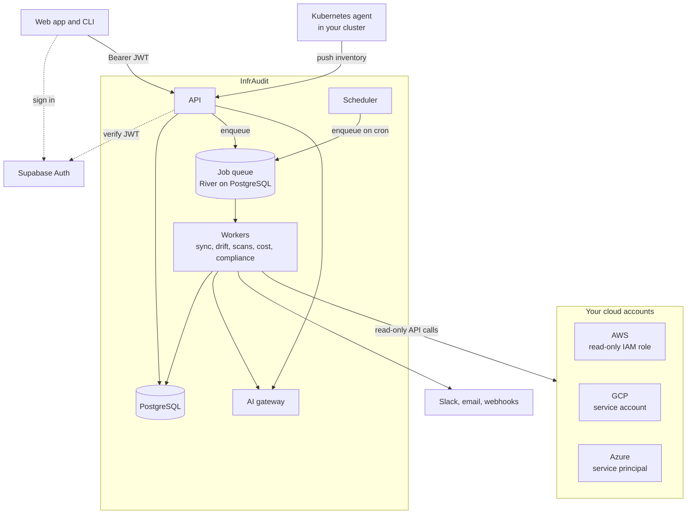

InfrAudit is a multi-service application. The components interact as shown below.



## Components

| Component | Technology | Purpose |
|---|---|---|
| **API** | Go 1.25+, Chi router | HTTP API for the web app, CLI and Kubernetes agent |
| **Workers** | Go, River | Run queued jobs: resource sync, drift detection, scans, cost sync, compliance |
| **Scheduler** | Go | Enqueues recurring jobs on cron schedules |
| **Frontend** | React 18, TypeScript, Vite, Radix UI | Web UI |
| **Database** | PostgreSQL 14+ | Primary data store and job queue |
| **Auth** | Supabase Auth | JWT signing, OAuth, user management |
| **AI** | AI gateway (Claude, Gemini, OpenAI, Azure AI Foundry, Kimi) | Recommendations and Scout investigations |
| **Scanning** | Trivy, NVD | Vulnerability scanning |

## Request flow

A typical authenticated API request follows this path:

```
Client
  │
  ▼
Chi HTTP router (cmd/api/main.go)
  │
  ├── Auth middleware (internal/api/middleware/auth.go)
  │     Validates Bearer JWT against SUPABASE_JWT_SECRET
  │     Resolves Supabase UUID to internal user ID
  │
  ├── Handler (internal/api/handlers/<feature>.go)
  │     Reads request, validates input
  │
  ├── Service layer (internal/services/<feature>.go)
  │     Business logic, calls repository and external APIs
  │
  └── Repository (internal/repository/<feature>.go)
        SQL queries against PostgreSQL
```

## Directory structure (backend)

```
infraudit-go/
├── cmd/
│   ├── api/          # API server entrypoint
│   └── cli/          # CLI entrypoint
├── internal/
│   ├── api/
│   │   ├── handlers/ # HTTP handlers by feature
│   │   └── middleware/
│   ├── services/     # Business logic
│   ├── repository/   # Database access layer
│   ├── providers/    # Cloud provider clients (AWS, GCP, Azure, K8s)
│   ├── scanners/     # Trivy integration
│   ├── ai/           # Gemini integration and rule-based fallback
│   ├── jobs/         # Cron job definitions
│   └── database/
│       └── migrations/
├── deployments/
│   ├── docker-compose.yml
│   └── kubernetes/
└── .env.example
```

## Data model

The core entity relationships:

```
Provider (cloud account)
  └── Resource (discovered cloud resource)
        ├── Baseline (configuration snapshot)
        ├── Drift (detected difference from baseline)
        ├── Vulnerability (CVE finding)
        ├── Recommendation (AI or rule-based suggestion)
        └── Remediation (proposed or applied fix)

Provider
  └── CostRecord (daily billing data)

ComplianceFramework
  └── Assessment
        └── ControlResult (pass/fail per control)
```

## Authentication flow

1. User signs in through the InfrAudit frontend (or directly via Supabase client).
2. Supabase issues a JWT signed with `SUPABASE_JWT_SECRET`.
3. The JWT is sent as `Authorization: Bearer <token>` on every API request.
4. The auth middleware in the Go API verifies the signature and expiry.
5. The middleware resolves the Supabase user UUID to an internal integer user ID for database queries.

## Job scheduler

Background jobs go through a [River](https://riverqueue.com) job queue stored in PostgreSQL. The scheduler enqueues recurring jobs on configurable cron expressions, the API enqueues jobs you start by hand, and workers run them. Job types:

- `resource_sync` — pulls inventory from cloud provider APIs
- `drift_detection` — compares current state against baselines
- `vulnerability_scan` — runs Trivy against scannable artifacts
- `cost_sync` — fetches billing data
- `compliance_assessment` — runs compliance frameworks
- `anomaly_detection` — flags unusual cost changes
- `recommendation` — generates cost and security recommendations
- `iac_scan` — scans infrastructure-as-code for drift and misconfigurations

Jobs write execution history (start time, duration, status, log) to the `job_executions` table.

## Scaling

The API is stateless (no in-memory session state), so API and worker instances scale horizontally. PostgreSQL is the shared state layer and also holds the job queue, so adding workers runs more jobs in parallel.
